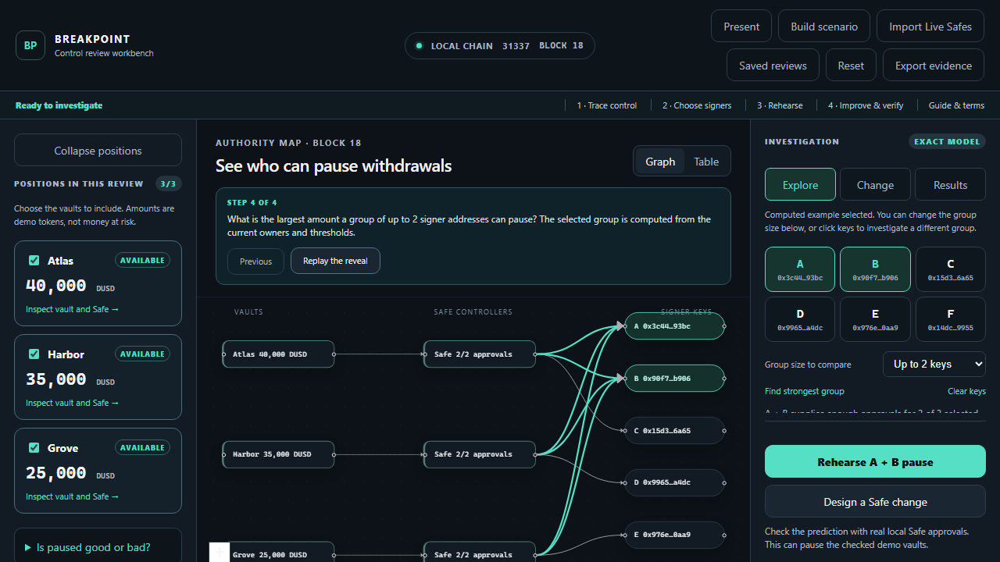

# BREAKPOINT

BREAKPOINT is a local-first control rehearsal workbench for Safe-governed DeFi positions. It discovers actual Safe owners and thresholds from chain state, computes the smallest signer coalitions that can pause selected withdrawals, executes those pauses through valid Safe approvals, and records receipts and observed consequences.

The guided demonstration begins with three 2-of-3 Safes controlling Atlas, Harbor, and Grove. A+B can pause all 100,000 DemoUSD units. Harbor is then changed through its Safe from A/B/D to C/D/F; replaying A+B pauses only Atlas and Grove (65,000 units), while Harbor rejects the Safe authorization and a real withdrawal still succeeds. The workbench also lets an operator deploy a different local three-vault configuration and investigate whichever signer group and portfolio subset they choose.

The core rehearsal runs on an isolated Hardhat chain (31337). No wallet, bought cryptocurrency, paid RPC, hosted database, AI API, account registration, or public network is required. The optional **Import Live Safes** view uses free public RPCs for read-only discovery; it never signs or submits public-chain transactions.



## Requirements

- Node.js 22.x (verified with 22.19.0)
- npm 10.x (verified with 10.9.3)
- A modern desktop browser for the demo; Google Chrome is required for the optional Playwright browser test (`channel: chrome`)
- Windows, macOS, or Linux; the checked-in lockfile pins dependencies

## Judge quick start

From a terminal in this folder (the one containing `package.json`), use Node.js 22.x and run:

```bash
npm ci
npm run compile
npm run build
npm run demo
```

Keep that terminal open. The last command starts **both** the isolated local blockchain (`127.0.0.1:8545`) and the website (`http://127.0.0.1:3000`). Open the website in a browser, wait for the local-chain status, and choose **Find shared control** for the guided example. No wallet, account, cryptocurrency, API key, or public RPC is required. A first install or build may take a few minutes. If compilation says **Nothing to compile**, the contract artifacts are already current; continue with the next command.

Press **Ctrl+C** in the demo terminal to stop both services. On a later visit, run `npm run demo` again; repeat installation/build only if dependencies or source files changed. The launcher refuses to start when port 8545 or 3000 is occupied, so stop any old BREAKPOINT process first. If the browser shows an older page, check for the terminal's `BREAKPOINT is ready` message and reload it.

If a restricted Windows environment reports `spawn EPERM` when starting the development server, use the already-built app in **two terminals** instead. Keep both terminals open:

```bash
# Terminal 1, in the project folder
node node_modules/hardhat/internal/cli/bootstrap.js --config hardhat.config.cjs node --hostname 127.0.0.1

# Terminal 2, also in the project folder
npm run start --workspace @breakpoint/web
```

Open `http://127.0.0.1:3000` as usual. This is the same local chain and application; the second command serves the production build rather than launching Next.js development mode.

To restore a clean scenario while the demo is running, click **Reset** in the app, or run `npm run demo:reset` in a second terminal from this folder. The local blockchain and demo tokens are ephemeral: restarting the demo creates a fresh chain. Browser-saved reviews remain historical records, not live chain state.

## Guided review

The question is **whether separate vaults depend on the same small group of Safe signer addresses to pause withdrawals**. A pause can help during an emergency but also stops withdrawals; neither `AVAILABLE` nor `PAUSED` alone certifies safety. The guided example uses 100,000 **DemoUSD units with no monetary value**, not real dollars or estimated losses.

Follow this path after the page loads (about 5–8 minutes):

1. Read the two-screen introduction. Choose **Find shared control** and **Start guided review**. If you have visited before, reopen the introduction with **Guide & terms**. The app automatically deploys the guided local scenario on first start; you do not need a wallet or to click **Build scenario** first.
2. Confirm Atlas (40,000 DUSD), Harbor (35,000 DUSD), and Grove (25,000 DUSD) are `AVAILABLE`. Click **Trace withdrawal control**, **Show Safe owners**, then **Explore signer groups**. The graph reveals vault → Safe → owner relationships in stages. Click **Table** for the exact owner/threshold rows. All three Safes initially need 2 of 3 approvals, and addresses A and B own each Safe.
3. In **Explore**, inspect the computed A+B group. It can authorize pauses for all three selected vaults: 100,000 DUSD, or 100% of the selected holdings. **Maximum with up to 2 keys** measures the widest reach of *any* two-address group; **Minimum keys for all** asks how many addresses are needed to reach every selected vault. Click signer keys or uncheck a vault to see the calculation change. Before continuing, reselect all vaults and click **Find strongest group** to restore the computed A+B example. Amounts are pauseable holdings, not predicted losses or compromise probabilities.
4. Click **Rehearse A + B pause**. The app obtains valid local approvals and calls each vault through its actual Safe. Wait for all three cards to say `PAUSED`. Open **Results** to compare predicted authorization with the observed Safe result and pause flag. The baseline rehearsal observes pause state; it does **not** attempt a separate blocked withdrawal from each paused vault. Open **Show receipts and save review** to inspect transaction hashes and Safe execution status.
5. Click **Reset for improvement**. Wait for a fresh local run and three `AVAILABLE` cards. Click **Design a Safe change**, then **Load guided Harbor example**. The proposal changes Harbor from owners A/B/D to C/D/F, keeping 2-of-3 approval. Its preview is **not yet on-chain**. Check both the selected A+B group's reach and the strongest group of up to two keys: each is predicted to fall from 100,000 to 65,000 DUSD. The minimum address count to reach all three rises from two to four.
6. Click **Apply through Safe**. The current Harbor owners authorize the change through the Safe, after which BREAKPOINT rediscovers its owners on-chain. Click **Replay A + B**. Atlas and Grove should become `PAUSED`; Harbor should remain `AVAILABLE`. In **Results**, Harbor's Safe authorization is rejected and a real one-unit Harbor withdrawal succeeds. Its current amount may show 34,999 DUSD because that verification withdrawal removed one demo unit. Other signer groups may still pause Harbor.
7. Expand the rejected Harbor event and successful withdrawal event in **Show receipts and save review**. Optionally name the review, add a note, and click **Save review locally**; **Saved reviews** reopens a historical, read-only record. Click **Export evidence** to download both a readable Markdown decision brief and a JSON evidence bundle with receipts and a SHA-256 digest. Your browser may ask permission for multiple downloads. Private fixture keys are never exported.

For a larger screen-share view, click **Present**. It enlarges the map and findings while hiding the position rail and technical evidence; click **Exit presentation** before showing receipts. **Build scenario** is a separate path for deploying three local vaults with editable names, allocations, Safe owners, and thresholds. To demonstrate customizability without changing the guided run, open the builder, inspect its fields, then close it; to test another arrangement, edit the fields and click **Deploy local scenario**. The reference amounts and results above are example expectations, not values hardcoded into the analysis.

## Optional: import live Safes

Click **Import Live Safes** next to **Build scenario**. Choose Sepolia (default), Ethereum, Base, Optimism, or Arbitrum, and enter 2–5 distinct Safe addresses. Click **Fetch & Map Architecture**. Reads happen on the server, so the browser does not depend on an external RPC's CORS configuration. No API key or wallet connection is needed.

For a quick public read, click **Load Sepolia examples**. These are two existing public test wallets; the app fetches their current configuration rather than loading saved results. They may have zero ETH and no overlapping owners. For a predictable overlap demonstration, click **Load local demo Safes** instead: it reads the actual three already-deployed Safe contracts on chain 31337. Their native balances are normally zero because DemoUSD sits in the vaults, not in the Safes.

The imported view shows the pinned block, Safe owners, thresholds, nonces, native ETH balances, shared owner addresses, and selectable graph/table views. **Show group for all** and **Show majority group** find the fewest owner addresses meeting the thresholds, with exhaustive calculation limited to 12 distinct owners. Larger imports still support mapping and manual selection. Majority is by Safe count, not balance. Zero-balance Safes still count.

This is an **owner-threshold model**, not the local withdrawal-pause model. A Safe's balance is not a vault position, and its owners do not establish which vaults it controls. Modules, guards and contract-owner policies can alter execution; detected additional controls are flagged. The importer recognizes standard Safe proxies and published singleton runtime hashes for versions 1.3.0, 1.4.1 and 1.5.0; other implementations receive an explicit error. Native ETH only is included in this release; ERC20 discovery and local forking of imported wallets are not implemented.

**Export read-only snapshot** downloads the imported configuration, selected addresses, model results and block identity as JSON. **Return to local rehearsal** restores your existing local investigation without changing its chain or selections. No rehearsal/apply buttons exist in the imported view. Public RPCs can be unavailable or rate-limited; inline errors preserve the previous view and the local preset remains available.

## Verification

These tests mutate or reset the local fixture. Stop the demo and use a fresh chain for verification; do not run them during a live review. Start the chain in one terminal:

```bash
npx hardhat node --config hardhat.config.cjs --hostname 127.0.0.1
```

Then, in another terminal:

```bash
npm test                 # contract + pure analysis tests
npm run test:scenario    # complete coordinator workflow against port 8545
npm run typecheck
npm run build
```

The import's validation and conditional threshold-model tests can be run without a public RPC:

```bash
node node_modules/mocha/bin/mocha.js test/live-safe.test.cjs
```

Optional read-only smoke check against the deployed local Safes (both servers must be running), or the two public Sepolia examples:

```bash
node scripts/verify-live-import.cjs local
node scripts/verify-live-import.cjs sepolia 0x6e6dca4c188d33d643d44201189cc64576bd0c82 0x01b0e211d4cb0615c5f5e8f83446bbcaeddc81c2
```

For the optional browser path, install Google Chrome and start the built app in a second terminal after the chain:

```bash
npm run start --workspace @breakpoint/web
```

Once the page is ready, run the browser test in a third terminal:

```bash
npm run test:e2e
```

`test:e2e` loads the guided scenario, verifies progressive discovery, signer and portfolio exploration, scoped rehearsal, reset, proposal preview, Safe-applied configuration change, replay, consequence evidence, local review save/export, responsive layout, presentation legibility, and dialog behavior. It separately deploys a different local scenario. It writes review images to `docs/screenshots/`.

## Architecture and truth boundaries

- `contracts/`: minimal pauseable vault and zero-value DemoUSD fixture token.
- `packages/core/`: deterministic, integer-only exhaustive coalition analysis for at most 12 distinct supported EOA owners.
- `packages/scenario/`: local deployment, pinned state discovery, Safe signing/execution, replay, idempotency, reset, and evidence export.
- `apps/web/`: Next.js workbench and loopback-only scenario API.
- `test/`: official Safe fixture tests, independent analysis oracles, integration workflow, and Playwright end-to-end test.

The demo deploys the official Safe 1.5.0 `SafeL2` singleton and `SafeProxyFactory`, then initializes actual proxy Safes. Vault pauses and owner changes use `execTransaction` with sorted EOA signatures; there is no impersonation, storage overwrite, module bypass, or fabricated flag manipulation.

Supported analysis is intentionally narrow: same-token integer balances, EOA Safe owners, no modules, guard, or fallback handler, and no more than 12 distinct owners. Unknown or unsupported controls are not called safe, and pause authority is not described as theft, malicious intent, compromised-key likelihood, people, price loss, or universal protocol safety.

The server accepts only loopback chain configuration and chain ID 31337. Fixture mnemonic material stays server-side and is never included in API responses or exports. Mutation routes require same-origin/loopback requests, a per-process session token, expected run identity, snapshot identity where applicable, and operation IDs.

## Documentation

- Product, design, architecture, contracts, analysis, and threat model: `docs/01_PRODUCT.md` through `docs/06_SECURITY.md`

## Limitations

This is a bounded local rehearsal, not an audit, certification, exploit scanner, price-risk model, or proof of complete safety. The builder currently supports exactly three fixture positions, three owners per Safe, and thresholds of one to three; it is not an arbitrary-contract importer. Saved proposals and reviews live only in this browser's local storage, while chain state is ephemeral and restarts clear it. The optional live Safe importer is read-only and limited to the owner-threshold model described above. The app does not execute on testnet/mainnet, model Safe module/guard/fallback behavior, infer beneficial ownership, or promise that an unavailable withdrawal is permanently unavailable. Local execution evidence records what the isolated-chain rehearsal observed; imported configurations are exported separately as read-only snapshots.

## License and attribution

Project code is provided for the hackathon prototype under the MIT License (see `LICENSE`). Safe contracts are consumed from `@safe-global/safe-smart-account` under LGPL-3.0; OpenZeppelin Contracts are MIT licensed. Dependency notices remain in their respective packages and lockfile.
